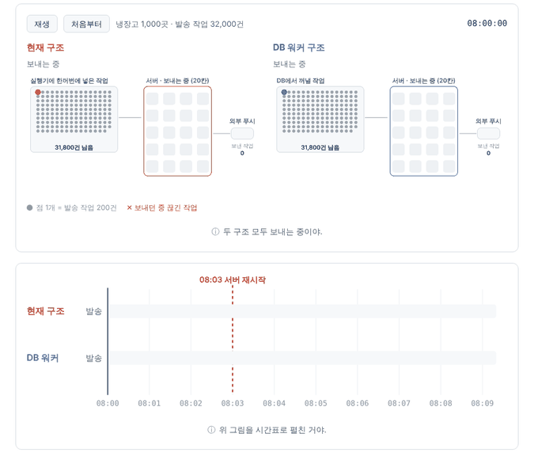
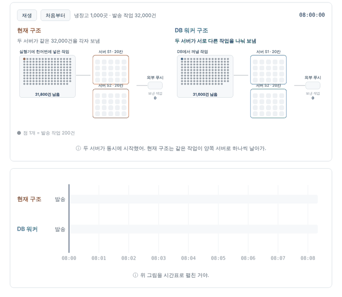
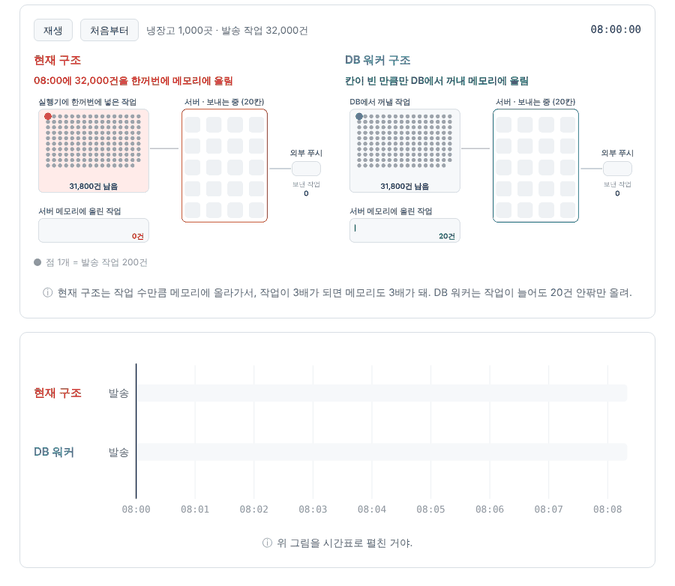
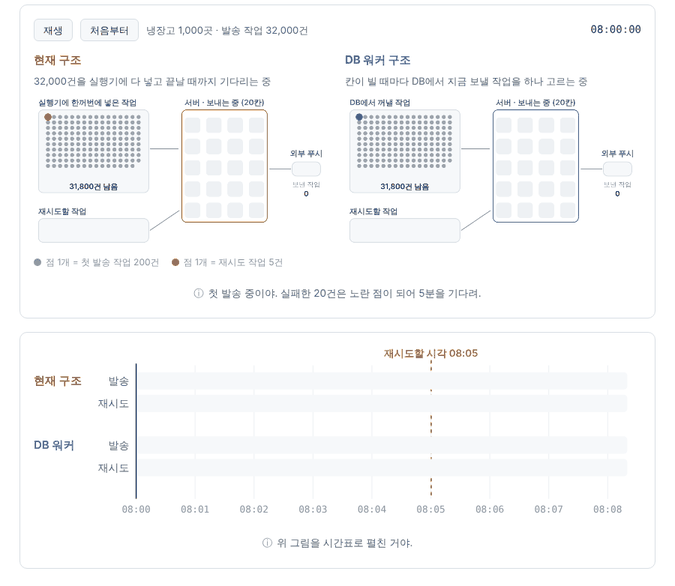

# 푸시 발송 구조 비교

08:00 만료·임박 알림 배치의 현재 발송 구조와 DB 워커 구조를 네 가지 상황에서 비교하는 시뮬레이션이다. `index.html`을 브라우저로 열면 바로 재생된다.

- 바로 보기: https://jung-min-ju.github.io/notification-sim/retry-delay-192/
- 관련 이슈: KTB4-5th-wiki #192, KTB4-5th-BE #211

## 어디까지 했나

- 현재 08시 배치 발송 구조와 DB 워커 구조를 네 상황(발송 중 재시작, 서버 2대, 메모리, 재시도 지연)에서 비교한다.
- 현재 구조 쪽은 실측(#192)과 코드에 맞췄다. DB 워커 쪽은 구현 전 설계를 기준으로 한 모델 예상이다.
- 블로그 삽입 모드: `?embed&s=restart|dup|mem|retry` (화면에 보일 때만 재생, 두 구조를 위아래로 배치).
- 이 시뮬레이터를 근거로 쓴 글: [푸시 알림 발송을 DB 워커로 바꾼 이유](https://dameokja.tistory.com/2)

## 관련 PR·이슈

| 구분 | 링크 |
|---|---|
| 측정 이슈 | [KTB4-5th-wiki #192](https://github.com/100-hours-a-week/KTB4-5th-wiki/issues/192) |
| 현재 구조 근거 BE PR | [#125](https://github.com/100-hours-a-week/KTB4-5th-BE/pull/125) 작업 처리, [#126](https://github.com/100-hours-a-week/KTB4-5th-BE/pull/126) 만료 푸시 스케줄러, [#128](https://github.com/100-hours-a-week/KTB4-5th-BE/pull/128) 작업마다 가상 스레드, [#130](https://github.com/100-hours-a-week/KTB4-5th-BE/pull/130) 스케줄러 통합 |
| DB 워커 구현 | [KTB4-5th-BE #211](https://github.com/100-hours-a-week/KTB4-5th-BE/issues/211) (진행 중) |
| 이 폴더의 PR | [#2](https://github.com/jung-min-ju/notification-sim/pull/2) 추가, [#3](https://github.com/jung-min-ju/notification-sim/pull/3) 삽입 모드, [#4](https://github.com/jung-min-ju/notification-sim/pull/4) 위아래 배치 |

## 현재 구조 (KTB4-5th-BE `dev`, 2026-10-11 기준)

- `NotificationScheduler.runExpirationNotificationBatch()`가 한 실행 안에서 다음 순서로 처리한다.
  1. 알림 생성
  2. 발송 작업 생성
  3. `sendPushNotifications()`
- `PushDispatchService.dispatchDueJobs()`
  - 보낼 작업을 전부 조회해 작업마다 가상 스레드를 실행기에 넣는다.
  - 동시 발송은 세마포어 20개로 제한한다.
  - 실행기가 모든 작업을 끝낼 때까지 기다린다.
- 그 뒤 `findNextAttemptAt()`으로 다음 재시도 시각을 찾는다. `Thread.sleep`으로 기다렸다가 다시 보내고, 정오까지 반복한다.
- 재시도 간격은 5분, 15분, 30분(`PushNotification.RETRY_DELAYS`)이고 발송 기한은 정오다.
- `dispatchDueJobs()`는 08시 배치에서만 호출된다.
- `findDueJobs`는 담당 표시 없이 조회만 한다.

## 네 가지 상황

| 상황 | 현재 구조 | DB 워커 구조 | 성격 |
|---|---|---|---|
| 1. 발송 중 서버 재시작 | 이어서 보낼 실행이 없어 남은 작업이 정오에 만료됨 | DB에 남은 작업을 다시 떠서 이어 보냄. 끊긴 작업은 점유 만료 후 회수 | 실패 제거 |
| 2. 서버 2대 | 서버마다 같은 작업을 읽어 같은 푸시가 두 번 나감 | 선점으로 한 작업은 한 서버만 보냄 | 실패 제거 |
| 3. 메모리에 올리는 양 | 작업 수만큼 실행기에 올림 (32,000건) | 빈 칸만큼만 꺼냄 (20건 안팎) | 규모 대응 |
| 4. 재시도 지연 (#192) | 첫 발송이 다 끝나야 재시도 (153초 지연) | 칸이 비면 재시도를 넣음 (약 0.3초) | 우선순위 트레이드오프 |

4번은 트레이드오프다. 칸 수는 같으므로 재시도를 먼저 넣으면 그만큼 첫 발송이 밀린다. 첫 발송과 재시도의 배분 비율은 설계에서 정한다.

## 장면

| 1. 발송 중 서버 재시작 | 2. 서버 2대 |
|---|---|
|  |  |
| **3. 메모리에 올리는 양** | **4. 재시도 지연** |
|  |  |

## 실측값 (이슈 #192)

| 조건 | 발송 작업 | 첫 발송 회차 시간 | 재시도 가능 시각 이후 지연 |
|---|---:|---:|---:|
| 냉장고 500곳 | 16,000건 | 227.046초 | 0.054초 |
| 냉장고 1,000곳 | 32,000건 | 453.788초 | 153.218초 |

실험 조건은 다음과 같다.
- 실제 08:00 배치 발송 경로를 격리된 MySQL에서 실행했다.
- 외부 푸시 응답은 250ms 스텁이다.
- 동시 발송은 20개다.
- 실패 작업은 실제로 5분을 기다린 뒤 재시도했다.

## 시뮬레이션 가정

- 처리량은 실측 회차 시간에 맞췄다(초당 약 70.5건). 점 1개는 작업 200건이다.
- 재시도: 첫 회차에서 실패한 작업은 처음 실행된 20건으로 가정했다.
- 재시작: 08:03에 재시작하고 20초 뒤 다시 뜬다고 가정했다. DB 워커가 끊긴 작업을 회수하는 시점은 점유 만료 40초 뒤로 가정했다.
- 서버 2대: 두 서버가 같은 시각에 08시 배치를 시작한다고 가정했다.
- DB 워커 구조는 구현·검증 전의 모델 예상이다.
- 측정 범위 밖: 실제 사용자 단말 수신 지연, API 부하, DB 연결 경합.
